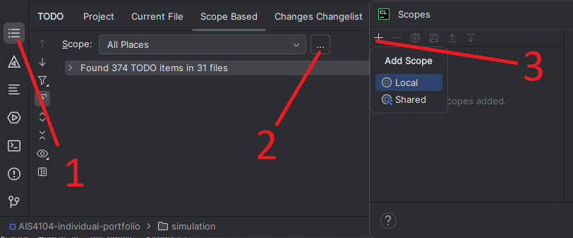
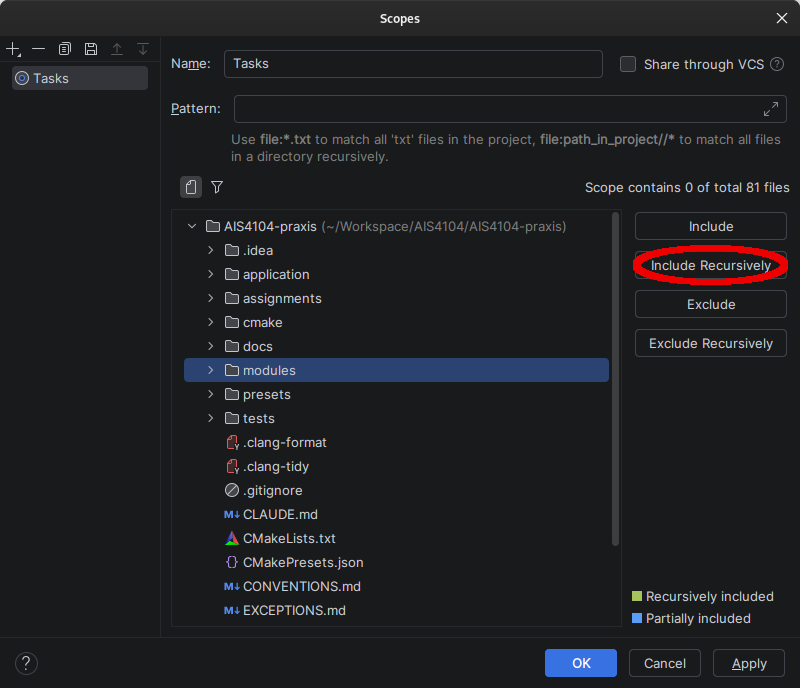
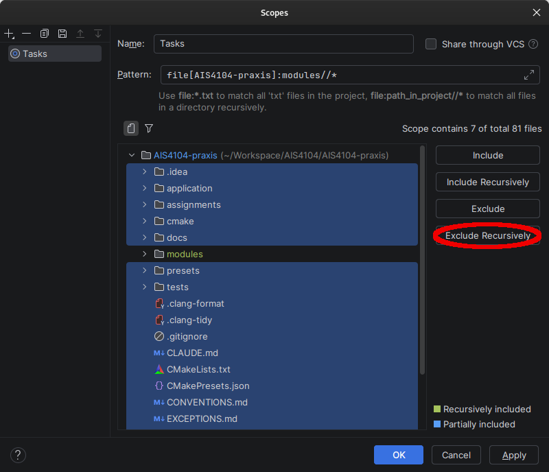

## Assignment 2

All your code in this assignment should land inside
`modules/modeling/chains.cpp`,
`modules/forward_kinematics/kinematics.cpp` or
`modules/velocity_kinematics/jacobian.cpp`.

There are five CMake targets of relevance:
1. `assignment_2_presets`: All presets in assignment 2 run your code, also from assignment 1.
2. `assignment_2_fk_baseline`: All forward kinematics presets in assignment 2 run your assignment 2 code, but rigid motions and screws use vendored logic.
3. `assignment_2_vk_baseline`: All velocity kinematics presets in assignment 2 run your assignment 2 code, but rigid motions, screws and FK use vendored logic.
4. `assignment_2_tests`: The unit tests for your assignment 2 code.
5. `exercise_fk_vk_presets`: Presets used for exercises that use vendored logic to demonstrate behavior.

## Updating from assignment 1

- `AIS4104-assignment-2.zip` holds everything assignment 2 adds and changes. Unzip it into the folder holding your
  assignment 1 project, the one with `CMakeLists.txt` in it, replacing the files already there.
- `modules/rigid_motion/frame.cpp` and `modules/rigid_motion/screw.cpp` are not in the archive and stay as you left
  them from assignment 1 <b>BUT DO MAKE A BACKUP JUST IN CASE</b>.
- On Windows, right-click the archive and choose Extract All. Change the destination to your assignment 1 folder,
  and choose to replace the files in the destination when asked.
- On macOS and Linux, open a terminal in your assignment 1 folder and run `unzip -o` followed by the path to the
  archive. On macOS, do not drag an extracted folder onto the old one in Finder: replacing a folder there deletes
  everything it held.
- Then delete the build directory (`build/` or `cmake-build-*`) and configure again.
- If you unzip assignment 2 over your project again, you will overwrite your code in the three files mentioned initially.
- If you start fresh, you might need to Build->Rebuild Project after copying over `screw.cpp` and `frame.cpp` from assignment 1.

## Assignment 1

All your code in this assignment should land inside `modules/rigid_motion/frame.cpp` or `modules/rigid_motion/screw.cpp`.

There are two CMake targets of relevance: 
1. `assignment_1_presets`: your code (in `frame.cpp` and `screw.cpp`) is used in these presets.</br>
2. `rigid_motion_presets`: presets with reference behavior that can be used to visualize topics of the book, or expected behavior for your assignment.

### Tests

The target `assignment_1_tests` can be ran to verify your code correctly implements the tasks according to the book.

`assignment_1_baseline_tests` is a second, optional target. It does not run under `ctest`; run it by name, with
the argument `"[.extended]"`. Rather than checking the frozen rows `assignment_1_tests` uses, it compares every one
of your functions against the reference over a thousand randomly drawn inputs, and reports the largest disagreement
it found for each. Use it when a task passes `assignment_1_tests` but you want to know whether it holds up away from
those rows. Everything it finds is reported as a warning; the run passes either way, so read the warnings rather
than the verdict. A disagreement near a half turn is expected, as the book's formulas lose accuracy there, which is
a property of the mathematics rather than a mistake in your code. A warning that a task "answered non-finitely"
means some drawn input drove your code to infinity or to not-a-number. The book decides its cases on exact
conditions such as "if R = I" and says nothing about how to decide them in floating point, so two reasonable
choices of test can leave a narrow band of inputs that neither case handles. Such a warning tells you where that
band is in your own code.

## Agentic coding and LLM assistance
Read the handout PDF requirements on the use of LLMs -- the handout states requirements and guidelines, 
whereas the files `docs/AGENTS.assisted.md` or `docs/AGENTS.socratic.md` dictate the LLM to act depending on how you wish to use LLMs for assistance.
Similarly, if relying on LLM services through webpages, rename the file you wish to use to `PRE-PROMPT.md` and upload it along with your initial prompt to the LLM. 
Ensure you get the history / prompt log artifact once you're finished with the session.

### Do not alter function signatures, file names or locations
Do not change return types, parameters or names of a function!
Do not move functions between files or move files in the project. 

You should only add code inside existing function bodies. 
However, you can add your own classes and types of you wish, but never modify the code architecture from the handout.

Submit source only — `build/`, `cmake-build-*/` and `.idea/` stay out. The `.gitignore` already lists them.

### Tasks

The tasks for the assignment are listed in the PDF handout, but the TASK-labels can be listed by CLion using the TODO-plugin.
Please note that the TASK-labels list may not be exhaustive, and that the assignment document takes precedence on  
tasks for the submission.

To show TASK-labels in CLion, add the following pattern under Settings->Editor->TODO->Patterns.

```
\btask\b.*
```

Then, create a custom named local scope of the TODO plugin to look for tags. Name it `Tasks`, `Assignment` or something similar. 
<p float="left">

</p>

Then, select the modules/ folder and click `Include recursively`.
<p float="left">
 
</p>

Similarly, to ensure documentation and assignment scaffolding files are omitted, select all folders, untick modules/ and click `Exclude recursively`. 
The configuration should be color highlighted as shown below. Afterwards, in the TODO-window, you should see 38 items under "Tasks" spread over five files, `modules/forward_kinematics/kinematics.cpp`, `modules/modeling/chains.cpp`, `modules/rigid_motion/frame.cpp`, `modules/rigid_motion/screw.cpp` and `modules/velocity_kinematics/jacobian.cpp`.
<p float="left">

</p>


### Reading a test failure

```
task 1e - frame.rotate_y case 0 residual inf / 0.000000e+00 allowed 1.000000e-13 / 1.000000e-13
```

`1e` is the task, `frame.rotate_y` the function to write, `case 0` which of its inputs was used.
The `residual` pair is how far your answer landed from the expected one — a magnitude, then a
linear error in metres — and `allowed` is how far each may land. An unwritten function misses by a
wide margin. A near miss is usually degrees where radians were wanted, or a matrix the wrong way
round.

### Building

| Platform | Toolchain |
|---|---|
| Windows | Visual Studio 2022 Build Tools with the C++ workload, or the MinGW toolchain CLion bundles |
| Linux | GCC or Clang, plus your distribution's OpenGL and X11/Wayland development packages |
| macOS | Xcode Command Line Tools |

The first configure downloads dependencies and needs network. Budget roughly 30 seconds to
configure, 3 minutes to build, and 2 GB of disk. This was measured on a desktop restricted to four cores
and the numbers are a floor, not an average; an older laptop or a slow connection takes several times as long.
Every build after the first will recompile only what you changed.

Run `assignment_1_tests` from the run configuration dropdown at the top right. On a fresh checkout
every task fails; that is what subtask 1.a) asks you to verify.

The project builds with 72 `-Wunused-parameter` warnings in `frame.cpp`,
`screw.cpp`, `kinematics.cpp`, `jacobian.cpp` and `chains.cpp` under GCC; other compilers may count and
name them differently. That is expected on an unimplemented checkout — each one goes away as you fill in
the task below it.

### Build issues or system hangup

**The build runs out of memory.** It compiles four files at once and peaked at 1.9 GB. Lower the
parallel job count under `Settings | Build, Execution, Deployment | Toolchains`.

**The first configure fails while downloading.** Check the network, then `File | Reload CMake
Project`. If a download was cut off, delete `build/` or `cmake-build-*` and configure again.

## Which executable is which

A build produces six preset executables. Each opens a window on one topic, and its name says whose
mathematics it runs on.

**Rigid motions**

| Target | Whose code it runs      |
|---|-------------------------|
| `rigid_motion_presets` | reference throughout    |
| `assignment_1_presets` | your rigid motions math |

**Assignment 2**

| Target | Whose code it runs |
|---|---|
| `assignment_2_presets` | your rigid motions, forward kinematics and velocity kinematics |
| `assignment_2_fk_baseline` | your forward kinematics over reference rigid motions |
| `assignment_2_vk_baseline` | your velocity kinematics over reference code beneath it |

**Exercises**

| Target | Whose code it runs |
|---|---|
| `exercise_fk_vk_presets` | reference throughout |

`rigid_motion_presets` runs on reference code throughout, over the same scenarios as
`assignment_1_presets`, so you can see how the topic should behave. `exercise_fk_vk_presets` runs on reference
code throughout and holds the exercises used in class, none of them an assignment preset.
`assignment_2_presets` runs on your code throughout. An `assignment_2_*_baseline` target
runs your code for that one topic and reference code for everything beneath it: reach for it to tell
whether a fault is in this assignment or in the previous one.

## What the first configure downloads

The first configure in a build tree fetches three robot descriptions — a KUKA KR6 R900 sixx, a
Universal Robots UR3e and a KUKA LBR Med 14 R820. That is roughly 46 MiB over the network and
roughly 140 MB on disk once unpacked. It happens once per build tree; configuring the same tree
again downloads nothing.

The fetch goes through CMake's own download path rather than git's, and the two do not share a
certificate store. A machine behind a proxy, or carrying a corporate certificate, can fail here even
though cloning this repository worked.

`MEIOS_RESOURCE_CACHE_DIR` sets where the descriptions are kept; it defaults to the build tree.
Point several build trees at one directory and they download the descriptions once between them.

```
cmake --preset default -DMEIOS_RESOURCE_CACHE_DIR=/path/to/shared/resources
```

The descriptions, their licence texts and the course's own models are copied beside the four
executables that open an arm — `exercise_fk_vk_presets`, `assignment_2_presets`, `assignment_2_fk_baseline`
and `assignment_2_vk_baseline` — as each of them builds, and each looks for them beside itself. Run one
from anywhere and it finds them; copy the binary somewhere without its neighbours and you will not
see an arm. The two rigid-motion previews, `rigid_motion_presets` and `assignment_1_presets`, draw
no robot, so they carry none of this and need none.

## When praxis version is bumped

This project builds against a fixed revision of the praxis library, and the course will move that
revision during an assignment. A build tree configured before the move keeps the old revision — it
does not pick the new one up, and the first sign is usually a compile error naming something you
never touched.

Delete the build directory and configure again. A fresh clone is never affected.
